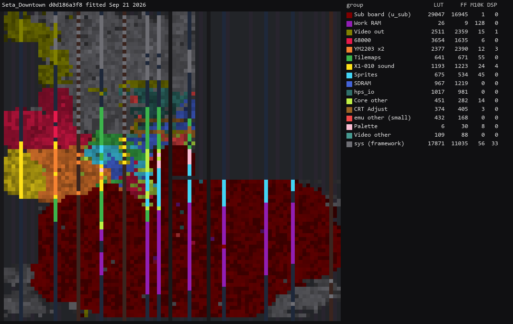

# Seta Downtown core for MiSTer

A MiSTer FPGA core for the [Seta](https://en.wikipedia.org/wiki/Seta_Corporation) boards MAME
covers in `seta/downtown.cpp` — a 68000 with a W65C02 sub CPU, the X1-001 sprite chip and the
X1-012 tilemaps — built with Quartus Prime 17.0.2 Lite for the DE10-nano.

Split from [Arcade-Seta_MiSTer](https://github.com/ppriest/Arcade-Seta_MiSTer) (`seta/seta.cpp`,
the same chipset without a sub CPU), which carries the history up to the split.

## Contents

- [History](#history)
- [Games](#games)
  - [Game Notes](#game-notes)
  - [Supported](#supported)
  - [Out of scope for now](#out-of-scope-for-now)
- [Hardware](#hardware)
  - [Video timing](#video-timing)
  - [Floorplan](#floorplan)
- [Screenshots](#screenshots)
- [Installation](#installation)
- [Status](#status)
  - [Todo](#todo)
  - [Resource usage](#resource-usage)
- [AI Attestation](#ai-attestation)
- [Verification](#verification)
- [Acknowledgements](#acknowledgements)
- [Layout](#layout)
- [License](#license)

## History

* **Arcade-SetaDowntown_20260921.rbf**
  * Thundercade: Revert the attempt to fix the sprite flickering. It turns out that it's correct precisely as it was (it draws the sprites to RAM every other frame/30Hz whilst rendering at 60Hz, leading to rendering mid-write [PCB recording](https://www.youtube.com/watch?v=g4TswNhGXjM))

* **Arcade-SetaDowntown_20260919.rbf**
  * Added Thundercade / Twin Formation
  * Note: Thundercade sprites still flicker in some scenes. The sprite snapshot is tied to the game's control register writes, so sprites update every other frame (removed in 20260921)
  * Rotary joysticks for DownTown with the Ikari Warriors core's controls: Rotate Left / Rotate Right buttons, Rotary Speed, GRS Super Joystick (keystroke mode). The options only show for DownTown
  * Downtown core: Use an impulse for reliable coin entry
  * Twin Eagle: the carrier no longer flickers

* **Arcade-SetaDowntown_20260918.rbf**
  * Core added: DownTown / Mokugeki (four sets), Twin Eagle
  * 68000 is now fx68k, cycle-accurate; TG68K ran 3.5x too fast, and was causing issues
  * CRT width: Match 384 option removed
  * DownTown ran too fast: the vblank interrupt was raised on both edges
  * Audio mix OSD option (Mono, None, 25%, 50%), defaulting to mono
  * DIPs with three or more bits (most coinage settings) showed only half their settings ([#6](https://github.com/ppriest/Arcade-Seta_MiSTer/issues/6))
  * `scripts/check_dips.py` and `scripts/check_inputs.py` check every `.mra`'s DIPs and every set's inputs against MAME

## Games

The goal is the boards MAME covers in `downtown.cpp`, minus the ones that overlap with Jotego's cores and U.S. Classic's trackball hardware.

### Game Notes

* **DownTown** - The "GRS Super Joystick" option is for players using the GRS Super Joystick, set to its keystroke mode. 

  * When it's on: Keyboard keys turn the stick. The Left and Right arrow keys rotate Player 1's stick, and C and V rotate Player 2's. In keystroke mode the GRS sends its spinner movement as exactly those key presses. When the setting is off, the core ignores these keys.
  * The rotation runs at the fastest rate. A held key steps the stick every 39 ms, the same as "Very Fast". It overrides the Rotary Speed setting, for the Rotate Left/Right buttons as well.

  * The Rotate Left and Rotate Right buttons work either way. The layout copies the Ikari Warriors core's option of the same name.

* **CRT adjust** (all games) - H-Size, H-Position and V-Shift for an analog CRT, from rmonic79's [Arcade-Raiden_MiSTer](https://github.com/rmonic79/Arcade-Raiden_MiSTer).

### Supported

All are ROT270 with a W65C02 sub CPU; sound is the X1-010 on the 68000, except Thundercade (YM2203 + YM3812 on the 65C02).

| Name | Year | Manufacturer | Main CPU | Tilemaps | Notes |
|-|-|-|-|-|-|
| Thundercade / Twin Formation | 1987 | Seta (Taito license) | M68000 @ 8 MHz + W65C02 @ 2 MHz | 0 | YM2203 + YM3812 |
| Twin Eagle - Revenge Joe's Brother | 1988 | Seta (Taito license) | M68000 @ 8 MHz + W65C02 @ 2 MHz | 1× 4bpp | Protection |
| DownTown / Mokugeki | 1989 | Seta | M68000 @ 8 MHz + W65C02 @ 2 MHz | 1× 4bpp | Rotary joysticks, Protection |

### Out of scope for now

| MAME description | Why |
|-|-|
| U.S. Classic (`downtown.cpp`) | Not yet: two trackballs through a uPD4701, colour PROMs, 6bpp tiles |

Caliber 50, Arbalester and Meta Fox run on this core and their `.mra` files are in
`unsupported/`, outside `releases/`: they overlap with Jotego's cores, so they are built
and checked here but not published.

## Hardware

| Chip | Function | Status |
|-|-|-|
| X1-001A + X1-002A | Sprites, and the "floating tilemap" made of sprite columns | Written, verified against MAME |
| X1-006 | Palette, `xRRRRRGGGGGBBBBB` | Written |
| X1-007 | Video blanking | Written |
| X1-010 | 16-voice PCM / wavetable sound | Written, verified against MAME |
| X1-004 | Input handling | Folded into the address decode |
| X1-005 / X1-009 | NVRAM | Zombie Raid's battery RAM, saved to the `.nvm` file |
| X1-011 | Graphics mixing | Written |
| X1-012 | Tilemaps | Written, verified against MAME |
| uPD71054C | Programmable interval timer (8254) | Written, channel 0 (the IRQ 4 timer) |
| ADC0834 | Zombie Raid's light gun ADC | Written |

### Video timing

Every game runs an 8 MHz dot clock (16 MHz / 2), 512 dots per line and 272 lines per frame:

* 8,000,000 / 512 = **15,625 Hz** line rate
* 15,625 / 272 = **57.4449 Hz** frame rate

MAME gives only refresh rates, and the `downtown.cpp` sets carry no "verified on PCB" comment.

Confirmed on a PCB: Guru's measurement of Caliber 50 (`downtown.cpp`, same X1-001 / X1-007 / X1-012 chipset) is **HSync 15.6250 kHz, VSync 57.4449 Hz** on X1-007 pins 22 and 23, the calculated values exactly.

Not every board measures the same:

| Board | HSync | VSync | Source |
|-|-|-|-|
| Caliber 50 (unsupported/) | 15.6250 kHz | 57.4449 Hz | `downtown.cpp`, Guru |
| Crazy Fight (`seta.cpp`) | 15.1433 kHz | 59.1851 Hz | `seta.cpp`, Guru |
| Thundercade (in this core) | 15.21 kHz | 59.1845 Hz | `downtown.cpp`, Guru |

Some links discussing the hardware:
* https://www.arcade-museum.com/manuf/Seta.html

### Floorplan

Where the logic sits on the Cyclone V, read from the compiled design with `scripts/floorplan.py` (blocks defined in `scripts/floorplan.json`). One cell per LAB, M10K or DSP site, coloured by the block owning most of it, brighter when fuller. The thin columns are M10K and DSP; the empty area at the top right is the HPS; grey is the MiSTer framework. LUT counts are combinational cells, two per ALM.

Revision `SetaDowntown`, fitted 21 Sep 2026 (before the split):

## Screenshots

### Thundercade / Twin Formation

### Twin Eagle - Revenge Joe's Brother

### DownTown / Mokugeki

## Installation

* Take the latest `*.rbf` from `releases/` and put it in `_Arcade/cores`, renamed to drop the `Arcade-` prefix: `Arcade-SetaDowntown_20260921.rbf` becomes `SetaDowntown_20260921.rbf`. The `.mra` files' `<rbf>SetaDowntown</rbf>` matches either name, but MiSTer launches the highest-sorting match, and any `SetaDowntown_*.rbf` sorts above every `Arcade-SetaDowntown_*.rbf`, so a prefixed copy left alongside is never used
* Take the `*.mra` files from `releases/` and subdirs and put them in `_Arcade`
* Put the MAME merged or split ROMs in `games/mame`

## Status

Known issues:
* **Thundercade** - Sprites flicker in attract. The game's vblank handler copies half of its sprite list to sprite RAM each frame and the list is rebuilt between the two copies, so sprite RAM holds two versions of it. MAME shows the same, and so does a [PCB recording](https://www.youtube.com/watch?v=g4TswNhGXjM), so the core draws every frame as it comes (`docs/MAME_DIVERGENCE.md`).
* **Twin Eagle** - The guns on the carrier deck run a frame behind the tilemap when it moves side to side. Want to confirm on a real PCB.

See `docs/MAME_DIVERGENCE.md` for cases that are considered 'hacks' from MAME, and also any cases where we diverge from MAME.

### Todo

- [ ] `hiscore.v` support, savestates
- [ ] Button names for the Downtown boards (`scripts/check_inputs.py` flags Thundercade)
- [ ] U.S. Classic: two trackballs through a uPD4701, colour PROMs, 6bpp tiles

### Resource usage

Whole core (the `SetaDowntown_stp` revision, which adds the debug probes), on the DE10-nano's
Cyclone V 5CSEBA6, speed grade 7:

| resource | used | available |
| --- | --- | --- |
| Logic (ALMs) | 37,000 (88%) | 41,910 |
| Block memory bits | 2,755,344 (49%) | 5,662,720 |
| RAM blocks | 367 (66%) | 553 |
| DSP blocks | 41 (37%) | 112 |
| PLLs | 3 | 6 |

## AI Attestation

This core is being developed with heavy use of a frontier coding assistant. The author is somewhat familiar with some of the games on this platform, being a co-author of the MAME driver.

## Verification

Not PCB-validated. MAME is the accuracy reference for the most part, with its own acknowledged uncertainties noted where they matter. Goal is to reconcile the inconsistencies and unlikely behaviour. The exception so far is flip screen, checked against the unflipped picture rotated 180 degrees rather than against MAME.

* Hardware facts come from the MAME driver and verified against it.
  * Graphics layouts were decoded from real ROM data before any RTL used them
  * The CPU is diffed against a real MAME trace
  * The sprite engine and the video path are diffed against MAME's own render
  * The sound is diffed against a line-by-line transcription of MAME's mixer.
  * The ROM_START records, the DIP switches to generate the `.mra` titles

* VBlank, Sprite and tilemap buffering behaviour (and divergent Blandia behaviour) validated by exhaustively checking and reconciling behaviours. See `docs\MAME_DIVERGENCE.md` and `docs\write_timing_mame.txt`

## Acknowledgements

- **Sorgelig** and the **MiSTer-devel team** for
  - the [Template_MiSTer](https://github.com/MiSTer-devel/Template_MiSTer) framework this project
    is seeded from
  - the SDRAM controller (`sdram.sv`, vendored via
    [Arcade-Jackal_MiSTer](https://github.com/MiSTer-devel/Arcade-Jackal_MiSTer), with burst-4
    reads added)
  - the screen-rotation module (`screen_rotate_two.sv`, from
    [Arcade-SKNS_MiSTer](https://github.com/MiSTer-devel/Arcade-SKNS_MiSTer))
- The **MAMEdev team** — in particular **Luca Elia** and **David Haywood** — for
  [MAME](https://github.com/mamedev/mame)'s `seta/downtown.cpp`, `video/x1_001.cpp` and
  `sound/x1_010.cpp`. There is no FPGA implementation of the X1-010 anywhere, so MAME's C++ is the
  whole specification for the sound chip.
- **Tobias Gubener** ([TobiFlex](https://github.com/TobiFlex)) for
  [TG68K.C](https://github.com/TobiFlex/TG68K.C).
- **Umberto Parisi** ([rmonic79](https://github.com/rmonic79)) for `crt_adjust.sv`, from
  [Arcade-Raiden_MiSTer](https://github.com/rmonic79/Arcade-Raiden_MiSTer).

## Layout

Standard [Template_MiSTer](https://github.com/MiSTer-devel/Template_MiSTer) structure:

| path | contents |
| - | - |
| `sys` | MiSTer framework, vendored from the template |
| `rtl` | core source |
| `releases` | `.mra` files, and the current `.rbf` |
| `docs` | design notes and hard-won debugging lessons |
| `sim` | ModelSim and Verilator testbenches |
| `scripts` | capture/verification tooling (see [`scripts/README.md`](scripts/README.md)) |
| `debug` | reference captures from MAME used as ground truth (gitignored) |
| `roms` | your own MAME sets (gitignored, never committed) |

## License

GPL v3 (see `LICENSE`). Imported components keep their own licences and are GPLv3-compatible:
TG68K.C (LGPLv3+), the adapted SDR SDRAM controller (Sorgelig, GPL-3.0-or-later),
`screen_rotate_two.sv` (Sorgelig, GPLv2 or later), `crt_adjust.sv` (rmonic79, GPL-3.0-or-later), and the MiSTer framework in `sys/`.

Game ROMs contain copyrighted material and are not included. Obtaining them is your
responsibility.
